# 👋 Hi, I'm MistyLunar

### Computer Science Student | Aspiring Software Engineer

I'm a Computer Science student passionate about software development and exploring emerging technologies.

- 🌱 Currently learning C, C++, Java, Python and Data Structures
- 💻 Interested in Backend Development and AI Agents
- 🚀 Building projects and exploring software engineering
- 📚 Learning Computer Science fundamentals, Linux and Git

---

## 🛠️ Tech Stack

---

## 📂 Featured Projects

- [C Learning](https://github.com/MistyLunar/C-learning)
- [Data Structure](https://github.com/MistyLunar/Data-Structure)
- [Java Learning](https://github.com/MistyLunar/Java-Learning)

---

## 📊 GitHub Stats

---

## 🐍 My Contributions

<picture>
  <source media="(prefers-color-scheme: dark)" srcset="https://raw.githubusercontent.com/MistyLunar/MistyLunar/output/snake-dark.svg">
  <source media="(prefers-color-scheme: light)" srcset="https://raw.githubusercontent.com/MistyLunar/MistyLunar/output/snake-light.svg">
  
</picture>

---

## 📫 Connect with Me

- GitHub: [MistyLunar](https://github.com/MistyLunar)
- Email: yuedan892@gmail.com
